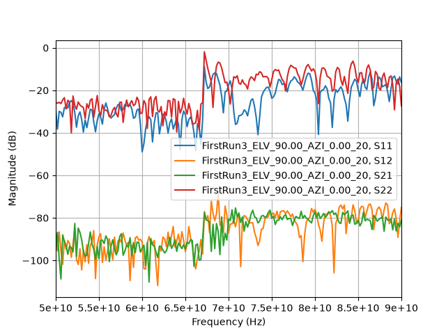
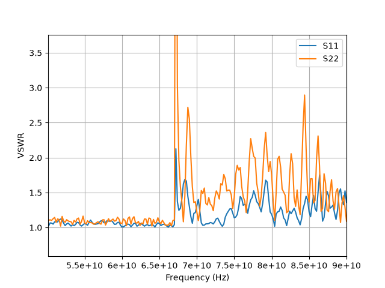

# First-working-data

CO-POL

# Development and progression
This document covers the development and progression of the project, including some design choices, and future ideas / options. 

## First Measurement
The figure seen in the [Above Figure](#First-working-data), which is a CO-POL measurement, shows the system does work correctly, by the fact that the general shape matches a very directional horn antenna. The key issue is the gain, as the measurement appears to be around -100 dB which is basically noise, therefore there is a code or setup issue. 
### Moving forward things to do
1. Find out why the gain / power is at -100 dB 
2. Do a sanity check - Put a termination on each port, and see how moving the axis affects the gain
    - Note that the phase is not of interest, as only the gain measurement is important, for antenna measurements. 
    - Remove horn, and attach it directly the the extenders to see the S11/S22 response, and compare that with the wave guide response. 
3. Do a CROSS-POL measurement (Same Setup)
4. Make code to plot RAW S Parameters for a single frequency 
5. Add Averaging function to remove fluctuations
6. Start Gain calibration 
7. Start Time Gating code 

## First CROSS POL Measurement  

This Cross Pol measurement, looking at the pattern makes sense in the idea that across azimuth the data is the same, as no power should be transmitted. 

## Plotting Raw S-Paramaters

This was done using skrf, which shows that the calculations for the s-parameters gain in the heat maps are correct. Therefore the low dB value is due to something else that is not code. Due to the S11 and S22 parameters being relatively high, the low dB values on S21 and S12 are therefore due to the chamber. 
 
Tests to do:

1. Sanity check by connecting the mm test sets to each other directly, and see how much gain / loss there is. 

## VSWR - for Test m. 
The VSWR for the 90 degree cut, from [this Data](../main/old_data/FirstRun3_20261124_151302/). The VSWR is plotted. The interesting thing, is that the VSWR is well below 2 for all most of the frequency points, and the S22 port has a higher VSWR due to the miss match of antennas used. The VSWR of the S11 antenna, should be 1.15:1 (Min, Max, Mean, the data sheet does not say) but for the most part, it is indeed below 1.15:1, if not slightly too good, as the horn is designed for 60-90 GHz, and at 50 GHz it still performs very well. 

