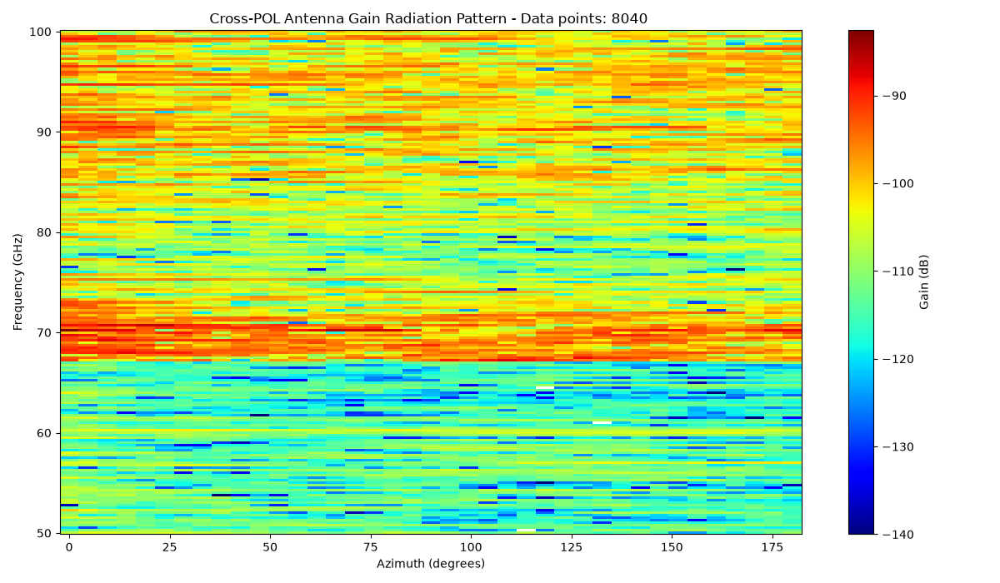

# First-working-data

CO-POL

# Development and progression
This document covers the development and progression of the project, including some design choices, and future ideas / options. 

## First Measurement
The figure seen in the [Above Figure](#First-working-data), which is a CO-POL measurement, shows the system does work correctly, by the fact that the general shape matches a very directional horn antenna. The key issue is the gain, as the measurement appears to be around -100 dB which is basically noise, therefore there is a code or setup issue. 
### Moving forward things to do
1. Find out why the gain / power is at -100 dB 
2. Do a sanity check - Put a termination on each port, and see how moving the axis affects the gain
    - Note that the phase is not of interest, as only the gain measurement is important, for antenna measurements. 
3. Do a CROSS-POL measurement (Same Setup)
4. Make code to plot RAW S Parameters for a single frequency 
5. Add Averaging function to remove fluctuations
6. Start Gain calibration 
7. Start Time Gating code 

## First CROSS POL Measurement  

This Cross Pol measurement, looking at the pattern makes sense in the idea that across azimuth the data is the same, as no power should be transmitted. 
